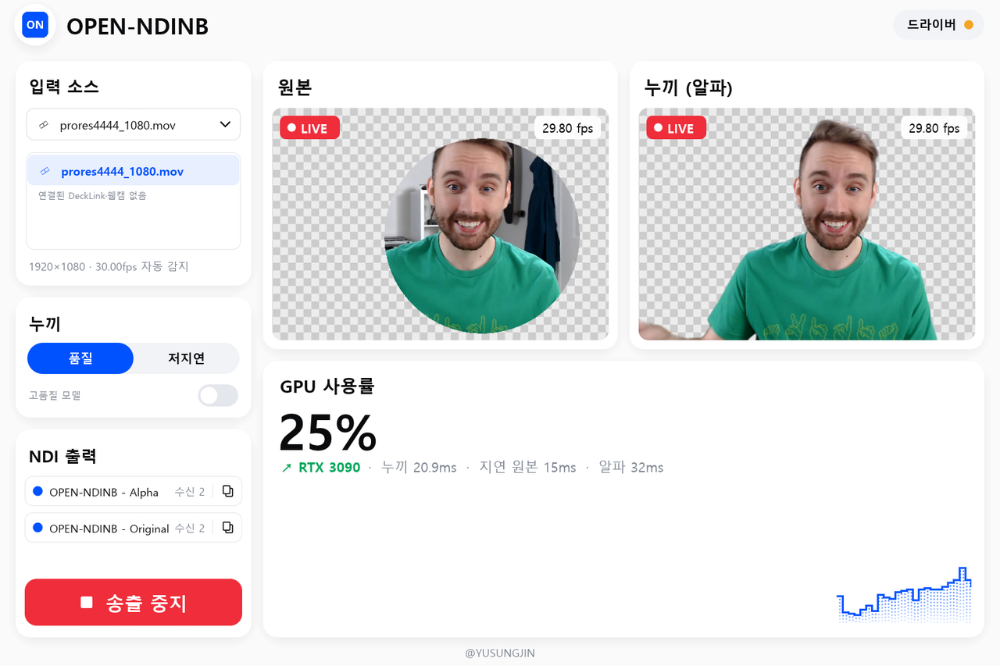

<p align="center">
  
</p>

<h1 align="center">OPEN-NDINB</h1>

<p align="center">
  <b>NVIDIA Broadcast 누끼를 알파 그대로 NDI로.</b><br>
  exe 하나. OBS도, 플러그인도, 그린스크린도, 설정도 필요 없음.
</p>

<p align="center">
  <a href="README.md">English</a>
</p>

<p align="center">
  
</p>

---

**OPEN-NDINB**는 카메라(블랙매직 DeckLink, 일반 웹캠)나 영상 파일을 받아서, NVIDIA Broadcast와 같은
NVIDIA AI Green Screen 엔진으로 사람만 오려 내고, **NDI 소스 두 개**로 바로 내보냅니다.

| NDI 소스 | 내용 |
|---|---|
| `<PC이름> (OPEN-NDINB - Alpha)` | 사람만, **진짜 알파 채널**(UYVA). vMix·OBS·Resolume·TouchDesigner·언리얼·Aximmetry에 바로 |
| `<PC이름> (OPEN-NDINB - Original)` | 원본. 누끼를 기다리지 않고 캡처 즉시 송출. ProRes 4444·DXV3처럼 알파가 있는 파일은 알파 유지 |

NVIDIA Broadcast는 *가상 웹캠*을 줍니다. OPEN-NDINB는 캡처 카드나 파일에서 바로 **알파가 살아 있는 NDI 소스**를 네트워크로 줍니다.

## 특징

- **NB 화질 그대로, NDI로 편하게.** 같은 Maxine AI Green Screen 모델을 쓰고, 납작한 가상 카메라 대신 알파 채널이 있는 NDI로 나갑니다.
- **exe 하나.** 약 37MB, 설치 없음. 빠진 런타임(NDI Runtime, NVIDIA 누끼 런타임, 블랙매직 드라이버)을 검사해 공식 다운로드 링크를 줍니다.
- **지연이 쌓이지 않는 구조.** 큐는 1프레임, 밀리면 옛 프레임을 버립니다. 원본은 누끼를 기다리지 않고 바로 나갑니다.
- **VJ 소재 그대로 재생.** ProRes 4444(알파 포함), Resolume DXV/DXV3, H.264, HEVC, MOV/MP4/MKV 반복 재생. ffmpeg 따로 설치 불필요.
- **GPU 사용률 실시간 그래프.**

## 측정 지연

같은 PC(RTX 3090, Threadripper PRO 3975WX)에서 캡처→NDI 수신, 1080p30, 저장소에 들어 있는 `ndi-probe`로 측정:

| 입력 | 원본 NDI (p50 / p95) | 누끼 NDI (p50 / p95) | 송출 fps |
|---|---|---|---|
| H.264 MOV 1080p30 | **47 / 53 ms** | **56 / 66 ms** | 30 / 30 |
| ProRes 4444 1080p30 (알파 포함) | 63 / 86 ms | 75 / 110 ms | 30 / 28 |
| Resolume DXV3 1080p30 | 65 / 88 ms | 77 / 108 ms | 30 / 29 |
| 파일 선택으로 연 H.264 | 45 / 53 ms | 62 / 83 ms | 30 / 30 |

누끼 처리 자체는 RTX 3090에서 1080p 한 장에 약 8~16ms, 나머지는 대부분 NDI 압축·전송입니다.
4K도 열리지만 지금은 원본 약 11fps, 누끼 약 7~10fps라 실시간 송출은 1080p 소재를 권합니다.

## 바로 쓰기

1. [Releases](https://github.com/sungjin031293-source/OPEN-NDINB/releases/latest)에서 **`OPEN-NDINB.exe`** 받기
2. 실행. 빠진 게 있으면 오른쪽 위 **드라이버** 버튼이 알려 주고 공식 설치 파일로 연결합니다.
   - [NDI 6 Runtime](https://ndi.link/NDIRedistV6) - 필수
   - [NVIDIA Video Effects 런타임(Maxine)](https://www.nvidia.com/en-us/geforce/broadcasting/broadcast-sdk/resources/) - 필수, 그래픽카드 세대에 맞는 것(앱이 골라 줌)
   - [Blackmagic Desktop Video](https://www.blackmagicdesign.com/support/family/capture-and-playback) - DeckLink 쓸 때만
3. 입력(DeckLink / 웹캠 / 영상 파일) 고르고, **품질** 또는 **저지연** 고르고 **송출 시작**
4. OBS·vMix·Resolume 등에서 NDI 소스 `<PC이름> (OPEN-NDINB - Alpha)` 추가

필요 환경: Windows 10/11 x64, NVIDIA RTX(튜링 이상).

## 소스에서 빌드

Windows, Rust stable(MSVC), Visual Studio Build Tools(MIDL 포함 Windows SDK).

```
cargo build --release
```

ProRes/DXV 디코더까지 넣으려면 FFmpeg 9 **LGPL shared** MSVC 빌드(예: [ffmpeg-msvc-prebuilt](https://github.com/System233/ffmpeg-msvc-prebuilt/releases)의
`ffmpeg-9.0.2_x64-windows-shared-lgpl.zip`)를 풀고 경로를 지정합니다.

```
set OPEN_NDINB_FFMPEG_DIR=C:\경로\ffmpeg-9.0.2_x64-windows-shared-lgpl
cargo build --release
```

재배포가 금지된 SDK 파일은 들어 있지 않습니다. `vendor/`에는 NDI·Maxine·DeckLink의 공개 인터페이스 헤더(각 파일에 허용 라이선스 명시)만 있고, 런타임은 모두 사용자가 설치한 것을 실행 중에 불러옵니다.

## 라이선스

MIT - [LICENSE](LICENSE). 함께 쓰는 외부 구성 요소와 라이선스(exe에 들어간 LGPL FFmpeg와 교체 방법 포함)는 [THIRD_PARTY_NOTICES.md](THIRD_PARTY_NOTICES.md)에 있습니다.

NDI®는 Vizrt NDI AB의 등록 상표입니다. NVIDIA, NVIDIA Broadcast, NVIDIA Maxine은 NVIDIA Corporation의 상표이고, Blackmagic Design과 DeckLink는 Blackmagic Design Pty. Ltd.의 상표입니다.
OPEN-NDINB는 Vizrt, NVIDIA, Blackmagic Design과 관계없는 독립 프로젝트입니다.

<p align="center"><sub>@YUSUNGJIN</sub></p>
