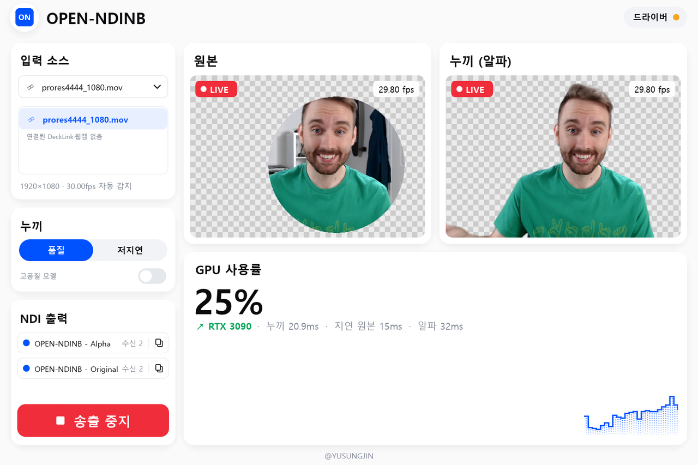

<p align="center">
  
</p>

<h1 align="center">OPEN-NDINB</h1>

<p align="center">
  <b>NVIDIA Broadcast-grade background removal, straight to NDI® with alpha.</b><br>
  One exe. No OBS, no plugins, no green screen, no setup.
</p>

<p align="center">
  <a href="https://github.com/sungjin031293-source/OPEN-NDINB/releases/latest"></a>
  
  
  
  
  
</p>

<p align="center">
  <a href="README.ko.md">한국어</a>
</p>

<p align="center">
  
</p>

---

**OPEN-NDINB** takes a camera (Blackmagic DeckLink, any webcam) or a video file, cuts the person out
with the same NVIDIA AI Green Screen engine that powers NVIDIA Broadcast, and publishes **two NDI sources**
your switcher picks up instantly:

| NDI source | What you get |
|---|---|
| `<PC> (OPEN-NDINB - Alpha)` | The person only, **real alpha channel** (UYVA) - drop it straight into vMix, OBS, Resolume, TouchDesigner, Unreal, Aximmetry... |
| `<PC> (OPEN-NDINB - Original)` | The untouched feed, sent the moment it is captured (it never waits for the AI). Files with alpha (ProRes 4444, DXV3) keep their alpha. |

NVIDIA Broadcast gives you a *virtual webcam*. OPEN-NDINB gives you a **keyed NDI source with alpha**, on the
network, from a capture card or a file, at one click.

## Why

- **NB quality, NDI convenience.** Same Maxine AI Green Screen models, but out over NDI with a true alpha
  channel instead of a flattened virtual camera.
- **One exe.** ~37 MB, no installer. It checks what is missing (NDI Runtime, NVIDIA Video Effects runtime,
  Blackmagic driver) and gives you the official download link in one click.
- **Low latency by design.** One-frame queues that drop stale frames instead of piling up delay, and the original
  feed is sent without waiting for the AI.
- **Plays the files VJs actually use.** ProRes 4444 (with alpha), Resolume DXV / DXV3, H.264, HEVC, MOV/MP4/MKV,
  looped, with a native file picker. No external ffmpeg needed.
- **Live GPU load graph** so you can see how much headroom you have.

## Measured latency

Capture -> NDI receive on the same machine (RTX 3090, Threadripper PRO 3975WX), 1080p30, `ndi-probe` included in this repo:

| Source | Original NDI (p50 / p95) | Alpha NDI (p50 / p95) | Output fps |
|---|---|---|---|
| H.264 MOV 1080p30 | **47 / 53 ms** | **56 / 66 ms** | 30 / 30 |
| ProRes 4444 1080p30 (with alpha) | 63 / 86 ms | 75 / 110 ms | 30 / 28 |
| Resolume DXV3 1080p30 | 65 / 88 ms | 77 / 108 ms | 30 / 29 |
| Video file (H.264) via file picker | 45 / 53 ms | 62 / 83 ms | 30 / 30 |

AI matting itself takes ~8-16 ms per 1080p frame on an RTX 3090. Most of the rest is NDI encode + network.
4K sources work but currently run at ~11 fps original / ~7-10 fps alpha - use 1080p for live.

## Quick start

1. **Download `OPEN-NDINB.exe`** from [Releases](https://github.com/sungjin031293-source/OPEN-NDINB/releases/latest).
2. Run it. If anything is missing, the **Drivers** button tells you what and links to the official installer:
   - [NDI 6 Runtime](https://ndi.link/NDIRedistV6) - required
   - [NVIDIA Video Effects runtime (Maxine)](https://www.nvidia.com/en-us/geforce/broadcasting/broadcast-sdk/resources/) - required, pick your GPU generation (the app picks it for you)
   - [Blackmagic Desktop Video](https://www.blackmagicdesign.com/support/family/capture-and-playback) - only for DeckLink input
3. Pick an input (DeckLink / webcam / video file), choose **Quality** or **Low latency**, press **Start**.
4. In OBS / vMix / Resolume / your switcher, add the NDI source `<PC> (OPEN-NDINB - Alpha)`.

Requirements: Windows 10/11 x64, NVIDIA RTX GPU (Turing or newer).

## Command line

```
OPEN-NDINB.exe --source decklink:0|webcam:0|file:<path>|pattern --start [--fast]
ndi-probe.exe --seconds 10 --out probe.json   # find both NDI sources, measure fps / latency / alpha
```

## How it works

```
DeckLink / webcam / file  ->  1-frame slot  ->  NDI "Original"      (sent immediately)
                                 \
                                  ->  1-frame slot -> GPU upload -> NVIDIA AI Green Screen -> UYVA -> NDI "Alpha"
```

- Capture: DeckLink (COM API), Media Foundation for webcams and common files, bundled FFmpeg (LGPL) for ProRes / DXV.
- Matting: NVIDIA Maxine Video Effects `GreenScreen`, loaded at runtime from the official NVIDIA redistributable.
- Output: NDI 6, loaded at runtime from the official NDI Runtime. Timecode = capture time, so any receiver can measure latency.
- UI: Rust + egui.

## Build from source

Windows, Rust stable (MSVC), Visual Studio Build Tools (with Windows SDK for MIDL).

```
cargo build --release
```

That builds without the embedded ProRes/DXV decoder. To embed it, download an **LGPL shared** FFmpeg 9 MSVC build
(e.g. `ffmpeg-9.0.2_x64-windows-shared-lgpl.zip` from [ffmpeg-msvc-prebuilt](https://github.com/System233/ffmpeg-msvc-prebuilt/releases)),
extract it and point the build at it:

```
set OPEN_NDINB_FFMPEG_DIR=C:\path\to\ffmpeg-9.0.2_x64-windows-shared-lgpl
cargo build --release
```

No proprietary SDK binaries are needed or included: the NDI, Maxine and DeckLink interface headers in `vendor/` are
their public, permissively licensed headers, and every runtime is loaded from the user's own installation.

## License

MIT - see [LICENSE](LICENSE). Third-party components and their licenses (including the bundled LGPL FFmpeg
libraries and how to replace them) are listed in [THIRD_PARTY_NOTICES.md](THIRD_PARTY_NOTICES.md).

NDI® is a registered trademark of Vizrt NDI AB. NVIDIA, NVIDIA Broadcast and NVIDIA Maxine are trademarks of
NVIDIA Corporation. Blackmagic Design and DeckLink are trademarks of Blackmagic Design Pty. Ltd.
OPEN-NDINB is an independent project, not affiliated with or endorsed by Vizrt, NVIDIA or Blackmagic Design.

<p align="center"><sub>@YUSUNGJIN</sub></p>
